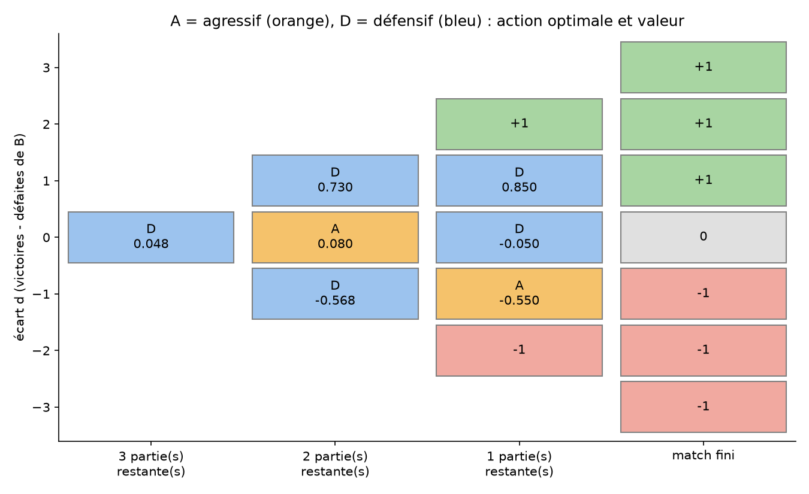

# Match d'échecs en 3 parties

Un joueur B plus faible choisit à chaque partie un style (agressif ou défensif).
Quelle stratégie maximise son espérance sur le match ?

## Modélisation (MDP)
- État : (parties restantes, écart de score d)
- Actions : agressif (A) ou défensif (D)
- Récompense finale : +1 si B gagne le match, 0 si nul, −1 s'il perd

## Résultat



Chaque case donne l'action optimale (lettre) et le gain espéré du match
(chiffre, entre −1 et +1) en jouant de façon optimale à partir de cet état.
Les valeurs se calculent par induction arrière, de la fin du match vers le début.

- En début de match, B a une espérance de **+0,048** : il est légèrement favorisé
  grâce à l'adaptation, alors qu'il est le joueur le plus faible.
- Avec une stratégie fixée à l'avance, il perd toujours en moyenne (au mieux −0,117,
  en jouant défensif trois fois).
- La stratégie optimale est prudente quand B mène et audacieuse quand il est mené.

## Lancer
```bash
pip install -r requirements.txt
python3 echecs.py          # 3 parties
python3 echecs.py --n 5    # 5 parties
```