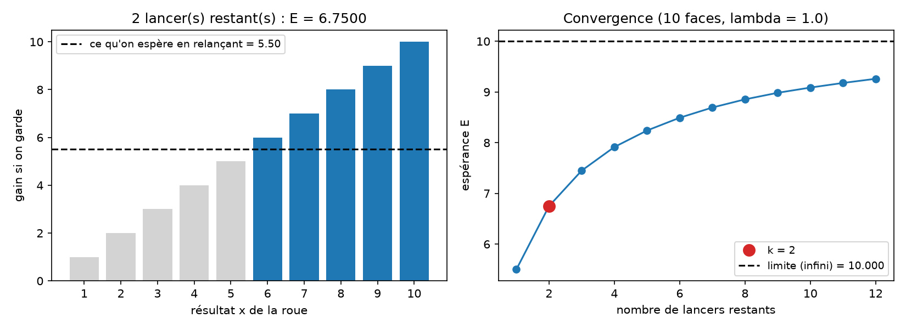

# Roue de la fortune : problème d'arrêt optimal

Une roue donne un entier uniforme entre 1 et 10. On dispose de plusieurs lancers :
après chaque résultat, on le garde (et on s'arrête) ou on relance.
Quelle règle maximise le gain espéré ?

## Modélisation
- État : le nombre de lancers restants k
- Actions : garder le résultat x, ou relancer
- Gain : x si on garde. Au dernier lancer, on est obligé de garder.

## Méthode : induction arrière
On part du dernier lancer et on remonte. Avec k lancers restants :

E[k] = moyenne sur x de max(x, E[k-1])

En mots : on garde x s'il dépasse ce qu'on espère en relançant. Le seuil d'arrêt est
donc E[k-1], et il augmente avec le nombre de lancers restants.

## Résultat



| Lancers restants | E[k]  | On garde si x ≥ |
|------------------|-------|-----------------|
| 1                | 5,5   | toujours        |
| 2                | 6,75  | 6               |
| 3                | 7,45  | 7               |
| 4                | 7,915 | 8               |

Plus on a de lancers, plus on peut se permettre d'être exigeant.

## Cas d'une infinité de lancers
Sans coût ni actualisation, la valeur tend vers 10 : on peut attendre la face maximale.
Avec un facteur d'actualisation λ < 1 (attendre fait perdre de la valeur), la valeur
est le point fixe de V = moyenne de max(x, λ·V). Par exemple, avec λ = 0,9 et 10 faces,
V ≈ 7,39. Le code le calcule par itération jusqu'à convergence.

## Lancer
```bash
python3 roue.py                      # 2 lancers, 10 faces
python3 roue.py --k 4                # 4 lancers
python3 roue.py --k 3 --lam 0.9      # avec actualisation
```